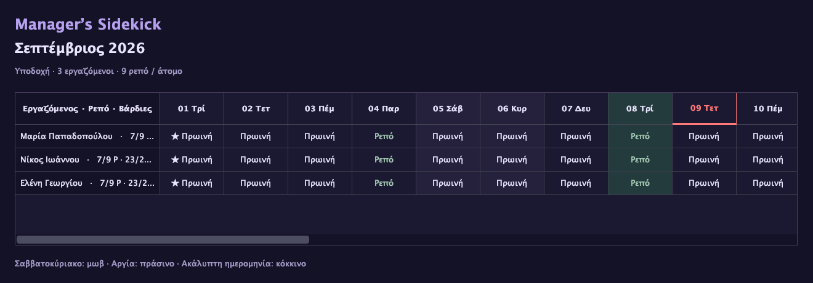
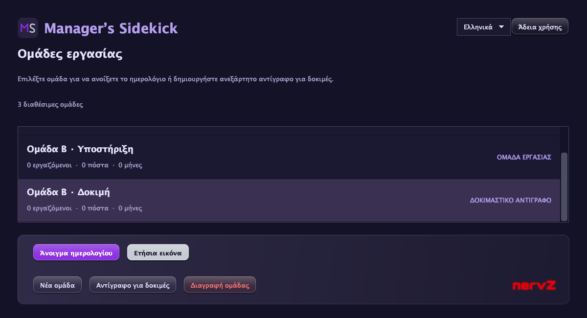
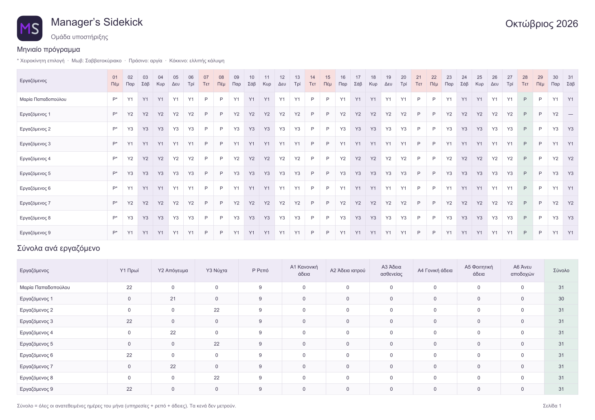

<p align="center">
  
</p>
<h1 align="center">Manager’s Sidekick</h1>
<p align="center"><strong>Ο προγραμματισμός βαρδιών, με τον έλεγχο στα χέρια σου.</strong></p>
<p align="center">by </p>
<p align="center"><strong><a href="README.md">English</a> · <a href="README.el.md">Ελληνικά — Ελληνική παρουσίαση</a></strong></p>
<p align="center">Windows · macOS · Linux &nbsp; | &nbsp; Ελληνικά / English &nbsp; | &nbsp; GPL-3.0</p>

Το Manager’s Sidekick είναι μια δωρεάν εφαρμογή ανοικτού κώδικα για τον μηνιαίο προγραμματισμό βαρδιών μιας ομάδας. Ορίζεις υπηρεσίες, δεξιότητες, διαθεσιμότητα και άδειες και υπολογίζεις το υπόλοιπο πρόγραμμα, διατηρώντας τις χειροκίνητες επιλογές σου.

**[Λήψεις](https://github.com/jimboL3t/managers-sidekick/releases) · [Πρώτα βήματα](docs/PUBLICATION.md) · [Εγχειρίδιο διαχειριστή](docs/ADMIN_GUIDE.md)**

> **Η έκδοση 1.7.0 είναι διαθέσιμη.** [Κατέβασε τα πακέτα με ενσωματωμένη Java](https://github.com/jimboL3t/managers-sidekick/releases/tag/v1.7.0).


*Προεπισκόπηση με ενδεικτικά δεδομένα. Το περιβάλλον και τα PDF υποστηρίζουν ελληνικά και αγγλικά.*

## Οργάνωσε τον μήνα της ομάδας σου

- **Ανεξάρτητες ομάδες:** ξεχωριστοί εργαζόμενοι, υπηρεσίες και άδειες, με αντίγραφα για δοκιμές.
- **Προγραμματισμός με κανόνες:** δεξιότητες, ημέρες λειτουργίας, ανάγκες κάλυψης, διαθεσιμότητα, ανάπαυση και συνεχόμενες ημέρες εργασίας.
- **Έλεγχος από τον διαχειριστή:** καταχώριση άδειας ή επιθυμητής υπηρεσίας, κλείδωμα ολόκληρων ημερών και αναζήτηση άλλων συνδυασμών για τα υπόλοιπα κελιά.
- **Δικαιότερη κατανομή:** ρυθμιζόμενη εξισορρόπηση νυχτερινών και Σαββατοκύριακων, προηγούμενοι μήνες αναφοράς και επιλογή συμμετοχής ανά εργαζόμενο. [Πώς λειτουργεί](docs/FAIRNESS.md).
- **Συνολική εικόνα:** ετήσια σύνολα, αποθηκευμένο ιστορικό και εξαγωγή μηνιαίου προγράμματος και συνόλων σε PDF Α4 οριζόντια.
- **Τοπική λειτουργία, δύο γλώσσες:** ελληνικά και αγγλικά, χωρίς λογαριασμό ή server. Τα δεδομένα παραμένουν σε τοπικά αρχεία.

Ο υπολογισμός γίνεται όταν τον ζητήσεις. Οι ελλείψεις και αποκλίσεις εμφανίζονται για έλεγχο. Ο αλγόριθμος χρησιμοποιεί περιορισμένη ευρετική αναζήτηση και δεν εγγυάται εφικτό ή βέλτιστο πρόγραμμα· έλεγξε το αποτέλεσμα πριν το χρησιμοποιήσεις. Χρησιμοποίησε μία εκτέλεση της εφαρμογής ανά φάκελο δεδομένων.

## Από την ομάδα στο εκτυπώσιμο πρόγραμμα

<details>
<summary><strong>Επιλογή ομάδας και ανεξάρτητα δοκιμαστικά αντίγραφα</strong></summary>



</details>

<details>
<summary><strong>Πρόγραμμα PDF και σύνολα εργαζομένων</strong></summary>



</details>

*Οι εικόνες παράγονται από πραγματικά στοιχεία του περιβάλλοντος και εξαγωγή PDF, με συνθετικά δεδομένα δοκιμών. Δεν αποτελούν ελεγμένα προγράμματα εργασίας.*

## Πρώτα βήματα

1. Κατέβασε την **1.7.0** από τα [Releases](https://github.com/jimboL3t/managers-sidekick/releases/tag/v1.7.0): Windows x64, Linux x64 ή macOS Apple Silicon. Περιλαμβάνεται Java.
2. Windows: αποσυμπίεση όλου του ZIP και εκκίνηση με `managersSidekick.exe`. Linux: αποσυμπίεση και `sh start-linux.sh` σε γραφικό περιβάλλον. Mac: άνοιγμα DMG και μεταφορά στο Applications.
3. Διάβασε τον [Quick Start Guide](https://github.com/jimboL3t/managers-sidekick/releases/download/v1.7.0/quickStartGuide.pdf), πρώτα στα αγγλικά και μετά στα ελληνικά.

Δεν υπάρχει πακέτο Intel Mac ή ARM Linux σε αυτή την έκδοση. [Εγκατάσταση και έλεγχοι](docs/DESKTOP.md).

**Backup πριν την αναβάθμιση:** κλείσε την εφαρμογή και αντέγραψε ολόκληρο το `data`. Windows/Linux portable: δίπλα στην εφαρμογή. Mac εγκατεστημένο: `~/ManagersSidekick/data`, έξω από το `.app`. [Οδηγίες μεταφοράς](docs/DESKTOP.md).

## Οδηγοί

| Θέλω να… | Οδηγίες |
|---|---|
| Οργανώσω ομάδες και υπολογίσω βάρδιες | [Εγχειρίδιο διαχειριστή](docs/ADMIN_GUIDE.md) |
| Κατανείμω νυχτερινά και Σαββατοκύριακα | [Δικαιότερη κατανομή](docs/FAIRNESS.md) |
| Εγκαταστήσω ή λύσω πρόβλημα | [Πακέτα λειτουργικών](docs/PUBLICATION.md) · [Εγκατάσταση](docs/DISTRIBUTION.md) |
| Μεταφέρω ή αποθηκεύσω τα δεδομένα μου | [Οδηγός backup](docs/BACKUP.md) |
| Καταλάβω την υλοποίηση | [Αρχιτεκτονική](docs/ARCHITECTURE.md) · [Έλεγχοι](docs/VALIDATION.md) |
| Δω τις αλλαγές εκδόσεων | [Ιστορικό](docs/CHANGELOG.md) |

## Εκκίνηση από τον κώδικα

Απαιτούνται **JDK 21+** και **Maven 3.9+**. Από τον φάκελο του repository:

```sh
mvn clean verify
java -jar target/managers-sidekick-1.7.0.jar
```

Βιβλιοθήκες εκτέλεσης: Gson και Apache PDFBox. Το Swing περιλαμβάνεται στη Java και το Maven εγκαθιστά τις εξαρτήσεις αυτόματα. [Οδηγίες δημιουργίας πακέτων και πηγών](docs/PUBLICATION.md).

## Άδεια και πηγές

Copyright © 2026 Dimitrios Diamantis. Η εφαρμογή διατίθεται με **GPL-3.0-only**. [Άδεια](LICENSE) · [Copyright](COPYING.md) · [Όροι διανομής](docs/LICENSING.md).

Κάθε διανεμόμενη έκδοση συνοδεύεται από **`all-sources.zip`** με τις αντίστοιχες πηγές εφαρμογής, βιβλιοθηκών και Java. Το αυτόματο Source code ZIP του GitHub περιέχει μόνο το repository. Οι άδειες και ειδοποιήσεις τρίτων περιλαμβάνονται στα πακέτα λειτουργικών.


## Νέο στην 1.7.0

Κατανομή πρωί/απόγευμα/νύχτα για παράλληλες υπηρεσίες, ασφαλείς ανταλλαγές και σαφέστερη λειτουργία εφεδρικού. Ενεργοποίηση: Σχεδιασμός προγράμματος → Κατανομή ωραρίων & ΣΚ. [Οδηγός κατανομής](docs/FAIRNESS.md).

## Από την 1.6.0

Προαιρετικά πρότυπα από εγκεκριμένα στιγμιότυπα προηγούμενων μηνών, με παράθυρο αναφοράς, ένταση επιρροής, εξαιρέσεις εργαζομένων και προεπισκόπηση. Η λειτουργία είναι αρχικά απενεργοποιημένη και εκτελείται τοπικά. [Οδηγός προτύπων](docs/PATTERNS.md).

Τα μενού οργανώνονται σε Ομάδα & υπηρεσίες, Εργαζόμενοι και Σχεδιασμός προγράμματος. Ο Quick Start Guide περιλαμβάνει πρώτα αγγλικά και μετά ελληνικά.

Λήψεις: Windows x64 ZIP με managersSidekick.exe, Linux x64 tar.gz και macOS Apple Silicon DMG. Περιλαμβάνεται Java. Δεν υπάρχει πακέτο Intel Mac ή ARM Linux. Οδηγίες εγκατάστασης, διατήρησης δεδομένων και backup: [Desktop](docs/DESKTOP.md).
