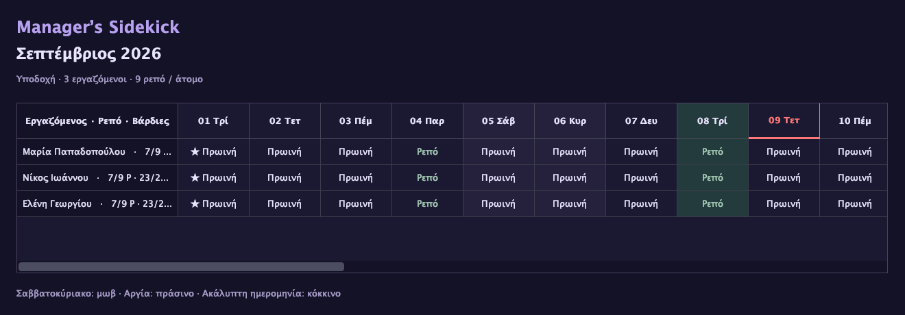
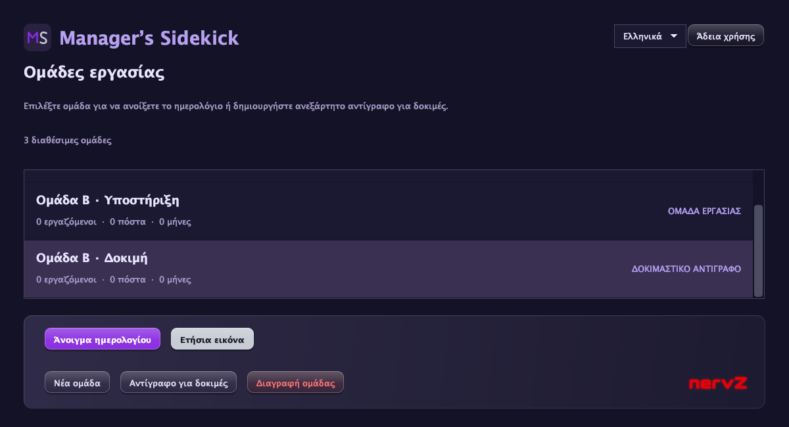
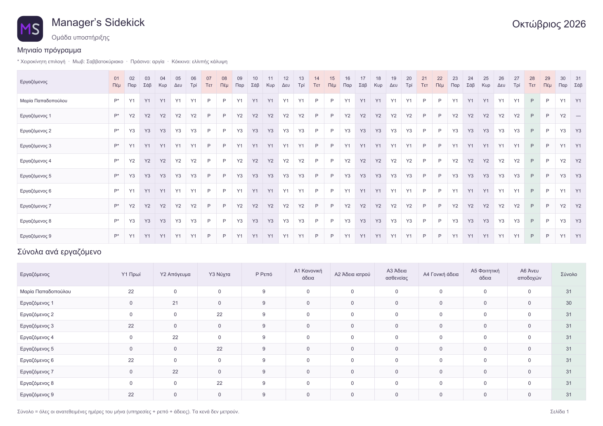

<p align="center">
  
</p>
<h1 align="center">Manager’s Sidekick</h1>
<p align="center"><strong>Shift planning, with you in control.</strong></p>
<p align="center">by </p>
<p align="center"><strong><a href="README.md">English</a> · <a href="README.el.md">Ελληνικά — Ελληνική παρουσίαση</a></strong></p>
<p align="center">Windows · macOS · Linux &nbsp; | &nbsp; Ελληνικά / English &nbsp; | &nbsp; GPL-3.0</p>

Manager’s Sidekick is a free, open-source desktop application for planning a team's monthly shifts. Define duties, employee skills, availability and leave, then calculate the remaining schedule while keeping your manual choices intact.

**[Downloads](https://github.com/jimboL3t/managers-sidekick/releases) · [Getting started](docs/DESKTOP.en.md) · [Administrator guide](docs/ADMIN_GUIDE.en.md)**

> **Version 1.7.0 is available.** [Download packages with Java included](https://github.com/jimboL3t/managers-sidekick/releases/tag/v1.7.0).



*Calendar preview with sample data. The interface and PDFs support both English and Greek.*

## New in 1.7.0

Balance morning, afternoon and night totals across parallel duties. Safe same-day swaps improve fairness while preserving coverage, workloads and manual choices. Reserves cover mandatory gaps and stay outside fairness comparisons. Enable **Shift mix & weekend balance** in Schedule planning; weights default to zero. [Setup and limits](docs/FAIRNESS.en.md).

## Plan your team’s month

- **Independent teams:** manage employees, duties and leave types separately; create a copy to try changes safely.
- **Scheduling rules:** account for skills, operating weekdays, staffing demand, availability, rest intervals and consecutive workdays.
- **Your choices stay in place:** assign leave or a requested duty, lock whole days and explore other combinations for the remaining cells.
- **Fairer distribution:** configure night/weekend balancing, reference previous months and control employee participation. [How it works](docs/FAIRNESS.en.md).
- **Approved history patterns:** optionally learn time-band preferences and adjacent shift sequences from months you approve. Preview the evidence, set influence and exclude employees. Rules and configured fairness take priority. [Pattern guide](docs/PATTERNS.en.md).
- **Clearer controls:** settings are grouped into Team & duties, Employees and Schedule planning; independently zoom days and employee rows.
- **A longer view:** review annual totals and saved history; export monthly schedules and employee totals to landscape A4 PDF.
- **Local and bilingual:** work in English or Greek without an account or server. Your data stays in local files.

Calculation runs when you request it. Coverage gaps and rule deviations remain visible for review. The scheduler uses a bounded heuristic, so it cannot guarantee a feasible or optimal schedule; review the result before using it. Use one app instance per data folder.

## From teams to a printable schedule

<details>
<summary><strong>Team selection and independent test copies</strong></summary>



</details>

<details>
<summary><strong>PDF schedule and employee totals</strong></summary>



</details>

*Images are rendered from real application components and PDF output using synthetic test data; they are illustrative, not validated work schedules.*

## Get started

1. Download **1.7.0** for Windows x64, Linux x64 or macOS Apple Silicon from [Releases](https://github.com/jimboL3t/managers-sidekick/releases/tag/v1.7.0). Java is included.
2. Windows: extract the entire ZIP and open `managersSidekick.exe`. Linux: extract and run `sh start-linux.sh` in a graphical desktop session. Mac: open the DMG and drag the app to Applications.
3. Read **[quickStartGuide.pdf](https://github.com/jimboL3t/managers-sidekick/releases/download/v1.7.0/quickStartGuide.pdf)**: English first, followed by Greek. Create a team, duties and employees, then calculate and review the schedule.

Windows/Linux packages are x64; the DMG is for Apple Silicon. No Intel Mac or ARM Linux package is included in this release. Windows binaries are unsigned and the Mac app is not notarized. See [installation and validation details](docs/DESKTOP.en.md).

**Back up before upgrading.** Portable data lives in `data/sidekick.json` beside the application. The installed Mac app uses `~/ManagersSidekick/data/sidekick.json`, outside the application. Close the app and copy the entire data folder before upgrading. [Backup and migration](docs/DESKTOP.en.md).

## Learning from approved history

Open **Schedule planning → Patterns from previous months**. Approve finalized months, select a reference window and participating employees, preview the recognized preferences, then enable the feature and calculate.

Patterns are **disabled by default** and run locally. They use morning/afternoon/night frequencies and adjacent pairs/triples, not arbitrary weekly templates. Leave, rest days, empty cells and holidays break sequences. Approvals store snapshots; later edits and newly generated months do not silently retrain them. [Full controls and limitations](docs/PATTERNS.en.md).

## Documentation

| I want to… | Read |
|---|---|
| Set up teams and calculate shifts | [Administrator guide](docs/ADMIN_GUIDE.en.md) |
| Learn from approved schedules | [History patterns](docs/PATTERNS.en.md) |
| Balance nights and weekends | [Fair distribution](docs/FAIRNESS.en.md) |
| Install or troubleshoot | [Platform packages](docs/DESKTOP.en.md) · [Installation](docs/DISTRIBUTION.en.md) |
| Back up or move my schedules | [Backup guide](docs/BACKUP.en.md) |
| Understand the implementation | [Architecture](docs/ARCHITECTURE.en.md) · [Validation](docs/VALIDATION.en.md) |
| See what changed | [Changelog](docs/CHANGELOG.en.md) |

## Build from source

Requires **JDK 21+** and **Maven 3.9+**. From the repository root:

```sh
mvn clean verify
java -jar target/managers-sidekick-1.7.0.jar
```

Runtime libraries: Gson and Apache PDFBox; Swing is included in Java. Maven resolves dependencies automatically. Packaging instructions and pinned dependency/runtime sources are described in the [publication guide](docs/DESKTOP.en.md).

## License and sources

Copyright © 2026 Dimitrios Diamantis. Application licensed under **GPL-3.0-only**. [License](LICENSE) · [Copyright](COPYING.md) · [Distribution details](docs/LICENSING.en.md).

Each distributed version includes a separate **`all-sources.zip`** with matching application, library and Java sources. GitHub's automatic source ZIP contains only this repository. Third-party licenses and notices remain included in the platform packages.
